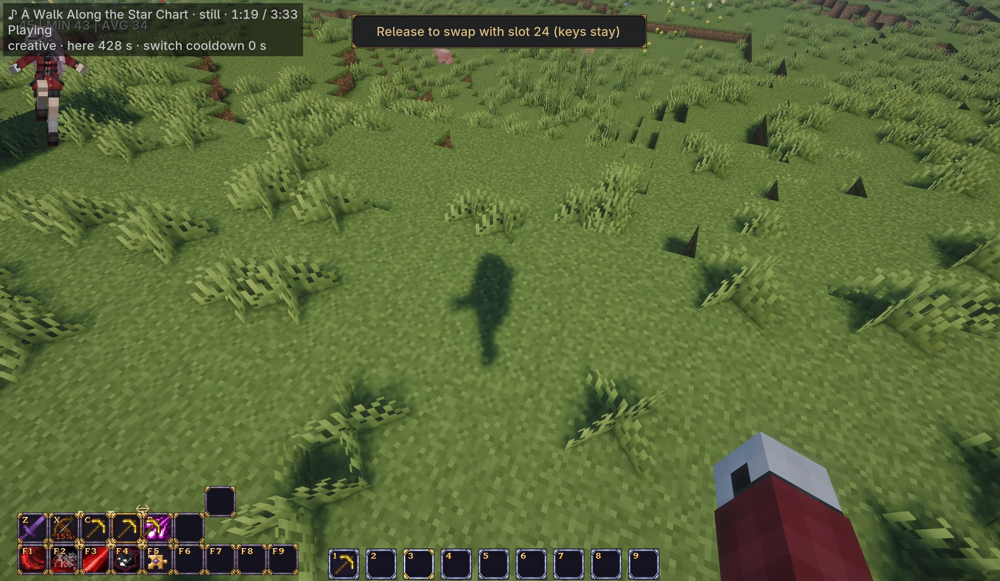
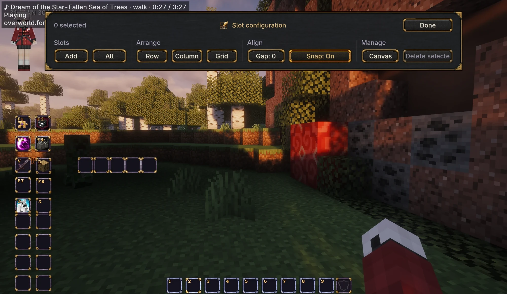
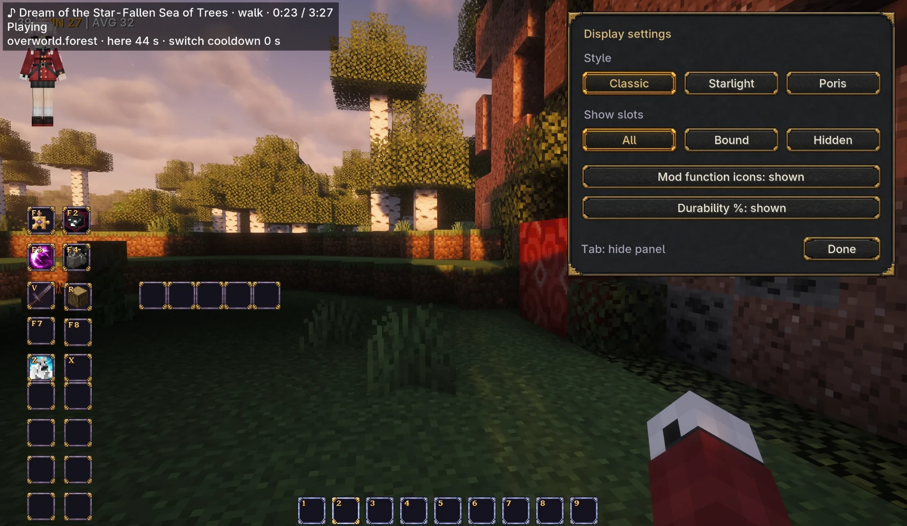
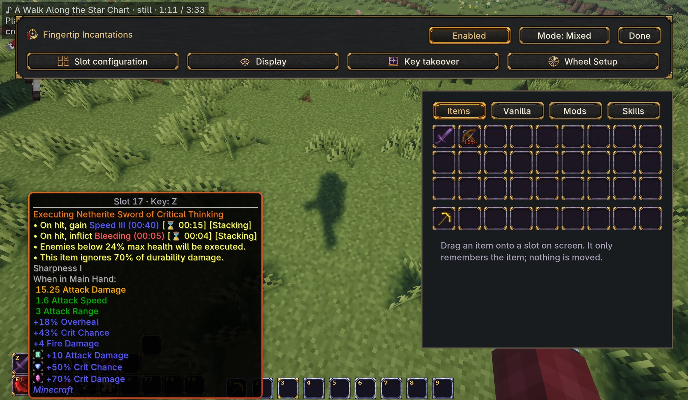
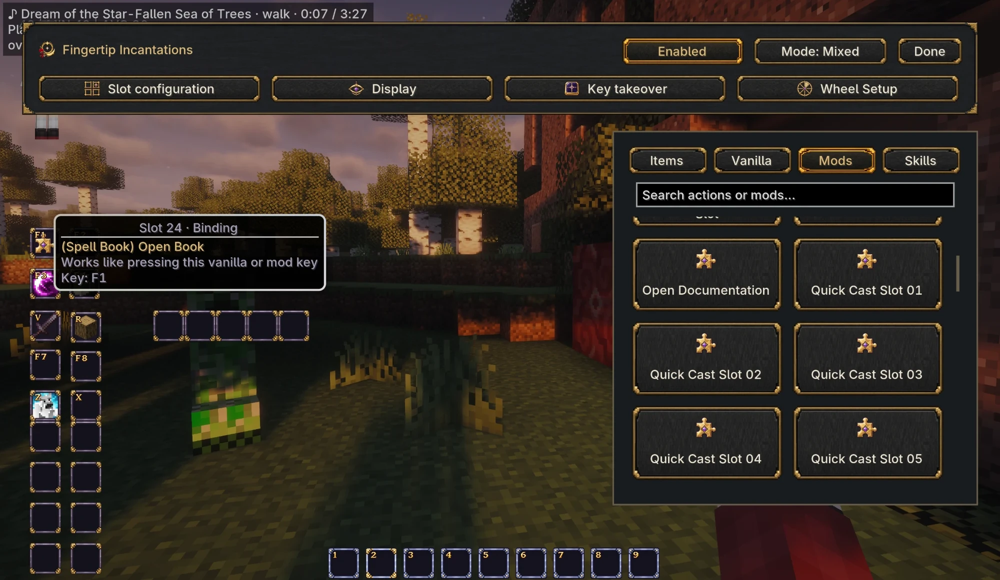
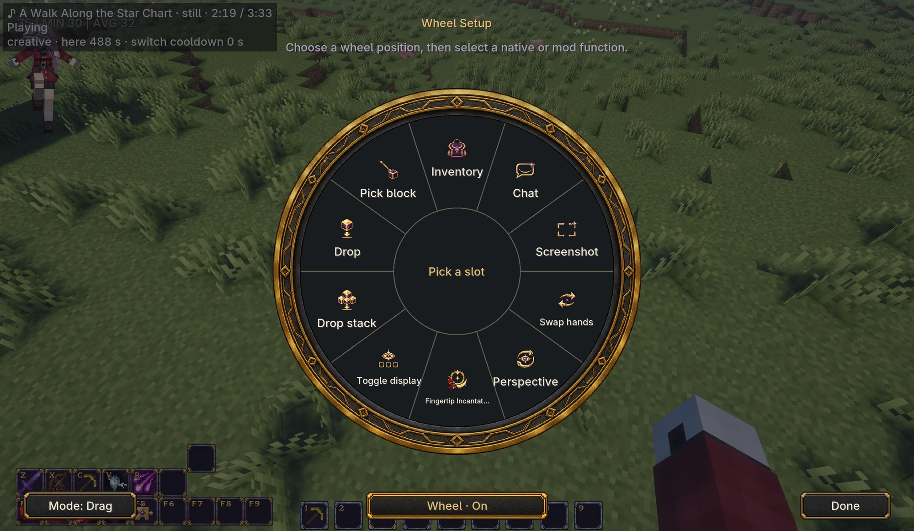
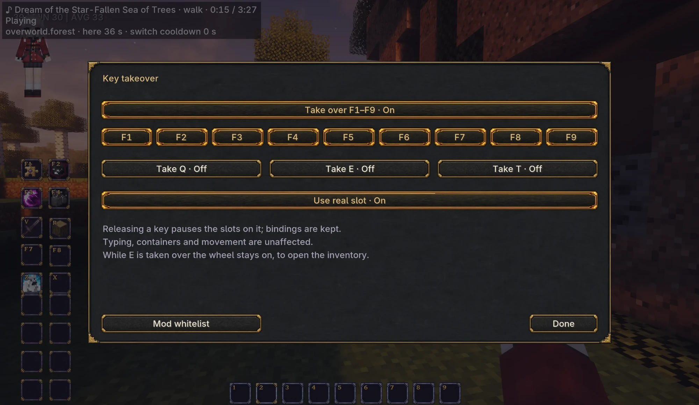
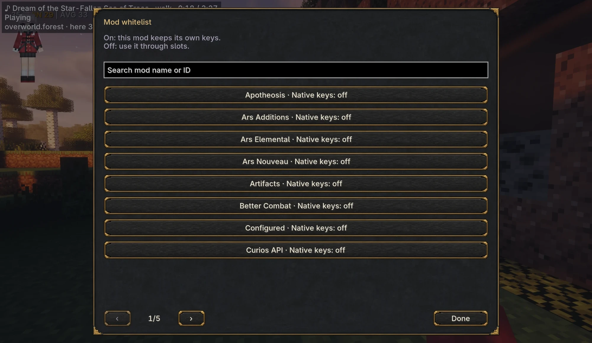
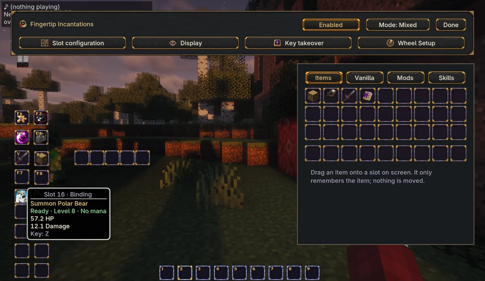

  

<strong>Keep the items, controls, and skills you use most within reach.</strong>

English · <a href="README.zh-CN.md">简体中文</a>

**Fingertip Incantations** is a customizable RPG-style hotbar. Equipment, supplies, vanilla actions, mod keybinds, and supported mod skills can all be bound to visible slots on the screen.

The slots point to your existing items. Selecting a sword equips that sword without moving it into a different inventory slot. Attacking, using items, placing blocks, and charging an action still use your normal controls.

| Requirement | Supported |
| --- | --- |
| Version | **1.0.0** |
| Minecraft | Java Edition **1.21.1** |
| Loader | **NeoForge 21.1.181 or later** for Minecraft 1.21.1 |
| Installation | Client and server; single-player uses its integrated server |
| Optional integration | Iron's Spells 'n Spellbooks **1.21-3.4.4 or later** |
| License | Source code: **MIT** · Logo and artwork: **All Rights Reserved** |

## Make the hotbar your own

Create and arrange slots around the screen. Bind items or actions by dragging them from the editor, swap two bindings by dragging one onto another, and clear a binding by dragging it into empty space. Alignment, snapping, and group arrangement help keep the layout tidy.

Choose between two modes:

- **Mixed:** keep the vanilla nine-slot hotbar and add Fingertip slots alongside it. The vanilla row moves as a group and keeps number-key and mouse-wheel selection.
- **Fingertip:** use Fingertip bindings for the original nine positions as well. Slots can be moved, rebound, or removed, and selection uses their assigned shortcuts.

The **Classic**, **Starlight**, and **Poris** themes share the same controls. Choose which slots remain visible and whether to show item durability percentages.

| Slot configuration | Display settings |
| --- | --- |
|  |  |

## Keep equipment and supplies close

Equipment bindings remember the particular item you chose, including tools or weapons with their own durability and data. Supply bindings, such as food or blocks, match by item type and data, and continue with another matching stack when the current stack is consumed.

Press a bound item's key to equip it. Press the same slot's key again to put it away and use an empty hand. Your items remain in the inventory; the HUD does not add storage slots.

## Put controls on the screen

Bind vanilla actions and supported mod keybinds to visible slots. The configurable radial menu also provides quick access to actions such as opening the inventory, switching perspective, swapping hands, dropping items, and opening the editor.

By default, **hold the middle mouse button, point at an action, and release**. A click-based mode is available too.

| Mod keybinds on slots | Wheel Setup |
| --- | --- |
|  |  |

**Key takeover changes how mod shortcuts work while the HUD is enabled.** Unbound mod shortcuts are not forwarded unless their mod is turned on in the **Mod whitelist**, opened from the **Key takeover** page. Movement, attack, use, and other basic controls remain available.

| Key takeover | Mod whitelist |
| --- | --- |
|  |  |

## See supported skills at a glance

The built-in Iron's Spells 'n Spellbooks integration adds available spells to the **Skills** page. Skill slots can display cooldowns, active states, charges, and recast counts when the integration provides them. Hovering can show the skill's own information, such as damage, range, or duration.

The spell's own mod still handles casting rules, resource costs, and gameplay effects. Fingertip supplies the interface and forwards the action. Other mods can add integrations through the public API.

## Start playing

1. Install the mod in your Minecraft instance. For multiplayer, the server and participating clients also need it.
2. Open your inventory and click the **Fingertip Incantations** logo near the upper-right corner.
3. Drag items or actions to slots, assign their shortcuts, and arrange the layout.
4. Check **Key takeover**, and in its **Mod whitelist** switch on any mods whose original shortcuts you want to keep.
5. Return to the world. Use your slot keys or open the radial menu with the middle mouse button.

See the [user guide](docs/USER_GUIDE.md) for mode differences, key conflicts, controls, and compatibility options.

## Compatibility

Fingertip works on its own with Minecraft and NeoForge. Iron's Spells is optional.

| Situation | Current behavior |
| --- | --- |
| Items in the vanilla player inventory | Supported as shortcut sources |
| A mod exposes standard Minecraft keybinds | Its functions can be assigned through the editor |
| An item needs its real inventory slot during right-click use | **Use real slot** in Key takeover exposes that slot during use (one global switch, on by default) |
| A mod reads physical input through its own system | May require a dedicated integration |
| Items inside a third-party backpack or container | Requires an inventory-source integration; containers are not automatically scanned |
| A skill from another mod | Requires a skill provider; arbitrary spells are not detected automatically |

In Fingertip mode, the mouse wheel does not select slots. Use their assigned keys, or use Mixed mode for vanilla hotbar selection.

## Development and feedback

- [Build from source](docs/BUILDING.md)
- [Skill and inventory integrations](docs/INTEGRATION.md)
- [Changelog](CHANGELOG.md)
- [Source license](LICENSE) and [artwork rights](ASSET_LICENSE.md)

Bug reports are welcome through the repository's Issues tab. Include the mod and NeoForge versions, whether the issue occurs in single-player or multiplayer, relevant mods, and steps to reproduce it.

## License

The source code, build scripts, configuration data, translations, and technical documentation are licensed under the **MIT License**.

The logo, textures, and other artwork remain **All Rights Reserved**. The [asset rights statement](ASSET_LICENSE.md) permits local builds and redistribution of unmodified official releases in modpacks. Third-party components retain their own licenses; see [third-party notices](THIRD_PARTY_NOTICES.md).
