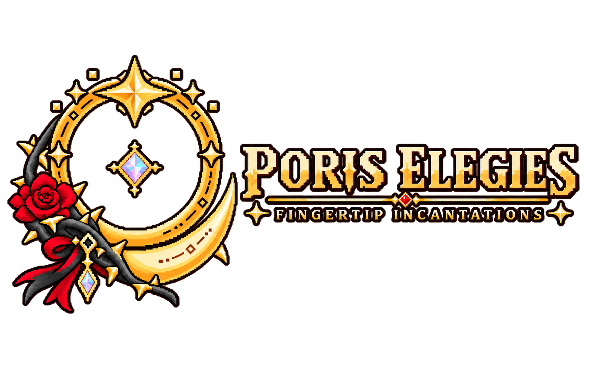
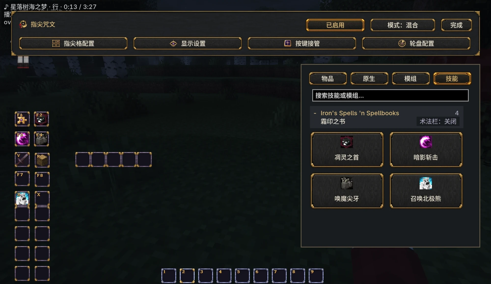
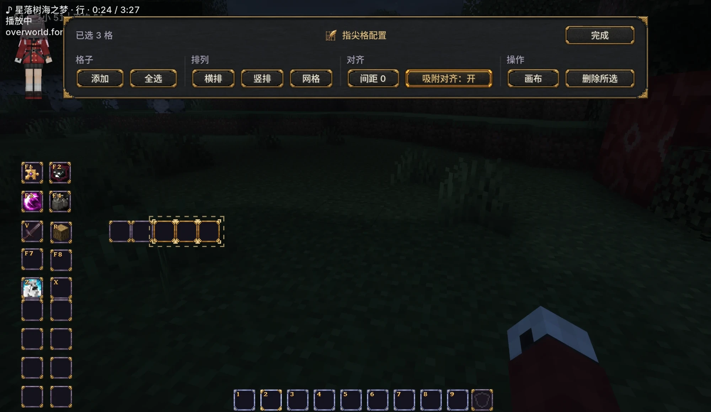
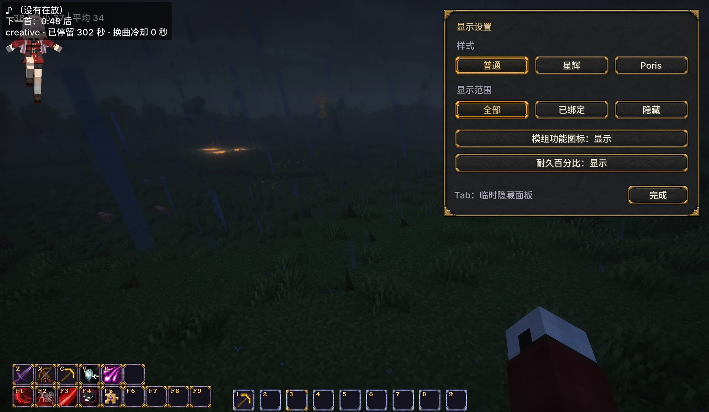
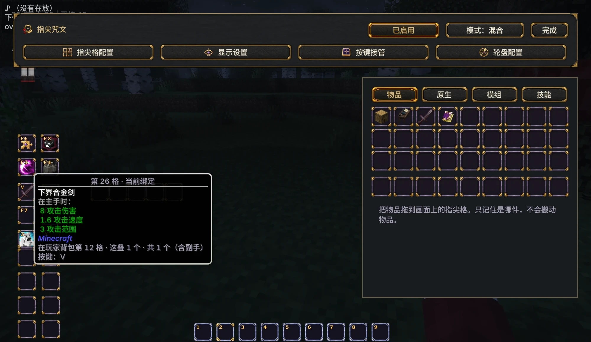
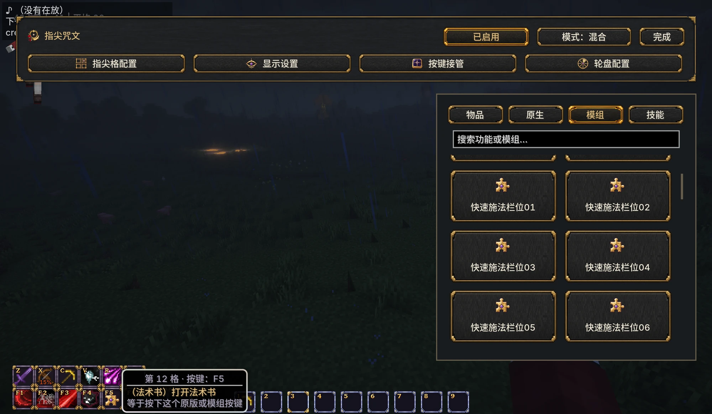
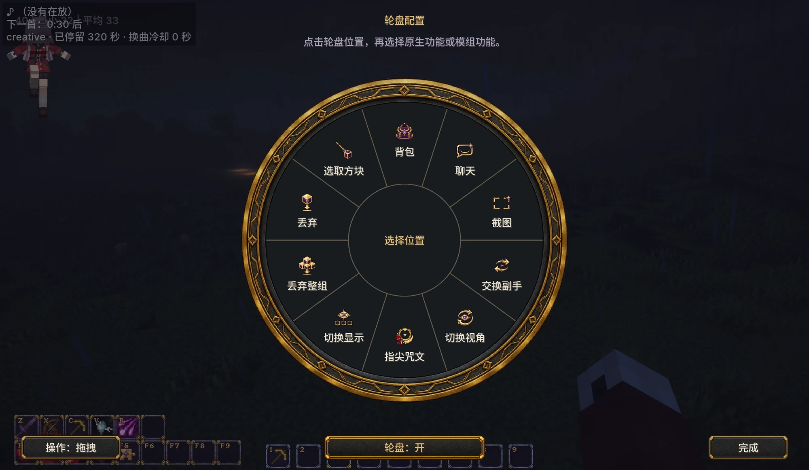
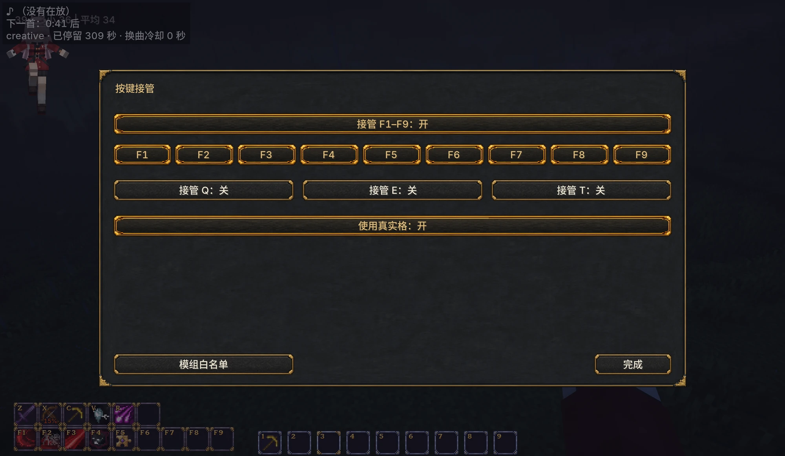
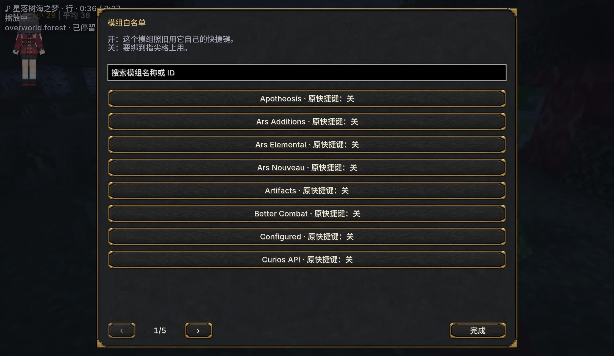
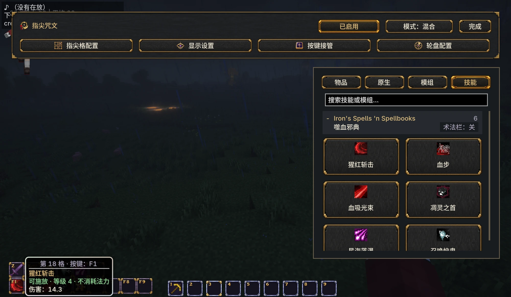

  

<strong>把常用的物品、按键和技能，放在顺手的位置。</strong>

<a href="README.md">English</a> · 简体中文

**指尖咒文**是一个可以自由编排的 RPG 风格快捷栏。装备、补给、原版动作、模组按键，以及已适配的模组技能，都可以绑定到屏幕上看得见的格子。

物品格指向你背包里已有的物品。按下剑对应的键，就把那把剑拿到手上，物品仍留在原来的位置；攻击、使用、放置和蓄力继续由你按平常的方式操作。

| 项目 | 支持范围 |
| --- | --- |
| 版本 | **0.2.3-beta** |
| Minecraft | Java 版 **1.21.1** |
| 加载器 | Minecraft 1.21.1 对应的 **NeoForge 21.1.181 及以上** |
| 安装端 | 客户端和服务端都要安装；单人游戏使用内置服务端 |
| 可选联动 | Iron's Spells 'n Spellbooks **1.21.1-3.15.5 及以上** |
| 许可 | 源码 **MIT**；Logo 与美术素材 **保留所有权利** |

## 按习惯编排快捷栏

把物品或动作拖到格子上绑定，拖到另一个格子交换，拖到空白处清空。格子可以自由放置，编辑时提供对齐、吸附和整组排列。

两种模式可以选择：

- **混合模式**：保留原版九格，再增加指尖格。原版九格作为一组移动，数字键和滚轮照常选原版格。
- **指尖模式**：原来的九格也使用指尖绑定，可以移动、改绑或删除，按各格自己的快捷键选择。

普通、星辉、Poris 三套主题使用相同的操作方式。你可以调整格子的显示范围，也可以显示工具与装备的剩余耐久百分比。

| 指尖格配置 | 显示设置 |
| --- | --- |
|  |  |

## 装备认这一件，补给认这一种

工具、武器等装备会记住你绑定的那一件，包括它自己的耐久与物品数据；食物、方块等补给按种类和物品数据寻找，一叠用完后继续使用下一叠匹配物品。

按下物品格的键拿到手上，再按同一个键收起为空手。HUD 格子是已有物品的快捷入口，不增加背包容量。

## 把操作放到屏幕上

原版动作和支持的模组按键可以绑定到格子。可配置的轮盘也能打开背包、切换视角、交换副手、丢弃物品或打开编辑器。

默认操作是：**按住鼠标中键，指向功能，松开执行**。也可以改成点击式轮盘。

| 模组按键绑到格子上 | 轮盘配置 |
| --- | --- |
|  |  |

**HUD 开启时，模组功能按键会由指尖接管。** 没有绑定到格子的模组按键，需要在「按键接管」页的「模组白名单」里打开对应模组后，才能继续按原来的方式使用。移动、攻击、使用等基础操作保留。

| 按键接管 | 模组白名单 |
| --- | --- |
|  |  |

## 看清已适配技能的状态

内置 Iron's Spells 'n Spellbooks 适配，其可用法术会出现在「技能」页。技能格可以显示适配方提供的冷却、开关状态、充能和再施放次数；悬停时还能显示法术自己的伤害、范围、持续时间等说明。

技能是否能够释放、消耗多少资源、产生什么效果，仍由技能所属模组处理。指尖负责显示与转发操作，其他模组可以通过公开接口接入。

## 第一次使用

1. 把模组安装到 Minecraft 实例；多人游戏的服务端和参与玩家也需要安装。
2. 打开背包，点击右上角附近的**指尖咒文 Logo**。
3. 把物品或动作拖到格子上，配置快捷键并调整布局。
4. 检查「按键接管」，在「模组白名单」里打开需要继续沿用原始快捷键的模组。
5. 返回游戏，使用格子的快捷键，或按中键打开轮盘。

更详细的模式、按键冲突和兼容选项说明见[使用指南](docs/USER_GUIDE.zh-CN.md)。

## 兼容范围

指尖可以只与 Minecraft、NeoForge 一起运行，Iron's Spells 是可选联动。

| 情况 | 当前行为 |
| --- | --- |
| 原版玩家背包中的物品 | 可作为快捷栏的物品来源 |
| 使用 Minecraft 标准按键系统的模组功能 | 可以在编辑器中绑定 |
| 物品右键使用时需要读取真实库存位置 | 「按键接管」里的「使用真实格」会在本次使用时提供该位置（全局开关，默认开） |
| 使用私有物理输入处理的模组 | 可能需要专门适配 |
| 第三方背包或容器里的物品 | 需要物品来源适配，不会自动扫描容器 |
| 其他模组的技能 | 需要技能提供者适配，不会自动识别任意法术 |

指尖模式下滚轮不切格，请使用格子快捷键；需要原版选格方式时可使用混合模式。

## 开发与反馈

- [从源码构建](docs/BUILDING.md)
- [技能与物品来源接口](docs/INTEGRATION.md)
- [更新记录](CHANGELOG.md)
- [源码许可](LICENSE)与[素材权利声明](ASSET_LICENSE.md)

反馈问题时请提供指尖版本、NeoForge 版本、单人或多人环境、相关模组和复现步骤，可通过仓库的 Issues 页面提交。

## 许可

源码、构建脚本、配置数据、界面翻译和技术文档采用 **MIT** 许可。

Logo、贴图和其他美术素材**保留所有权利**。[素材权利声明](ASSET_LICENSE.md)允许本地构建，并允许将未经修改的官方发行包加入整合包分发。第三方组件保留原有许可，见[第三方声明](THIRD_PARTY_NOTICES.md)。
